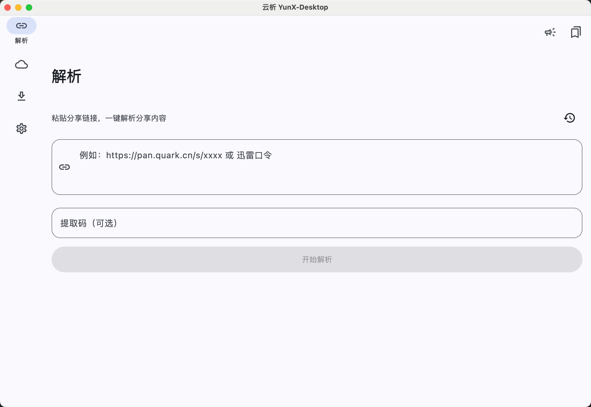
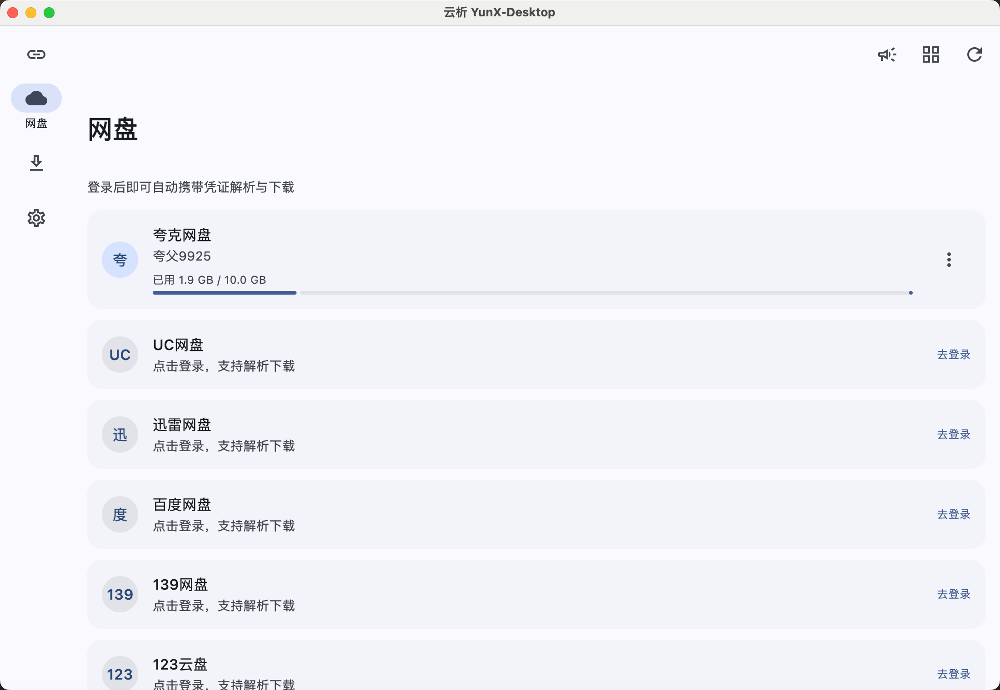
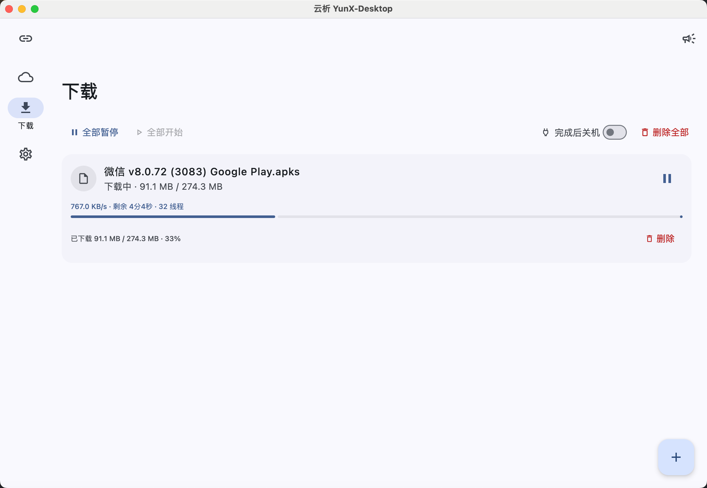
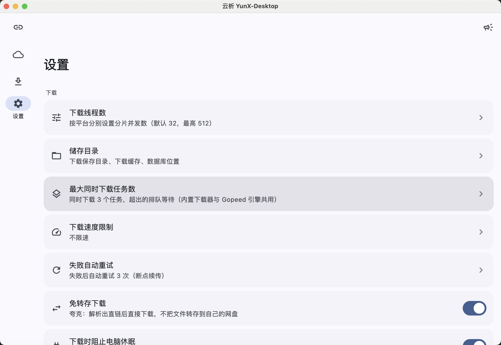
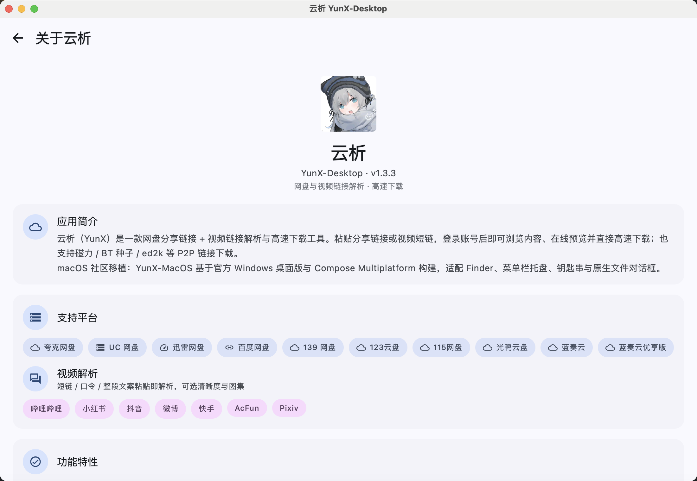

<div align="center">


# 云析桌面版 · YunX-MacOS

**粘贴分享链接，直接高速下载 —— 云析 YunX 的 macOS 桌面版**

网盘：夸克 / UC / 迅雷 / 百度 / 139 / 123 / 115 / 光鸭 / 蓝奏云 / 蓝奏云优享版；
视频：哔哩哔哩 / 小红书 / 抖音 / 微博 / 快手 / AcFun / Pixiv；另支持磁力 / BT 种子 / ed2k 等 P2P 链接。
Range 分片并发 + 断点续传，B 站高清自动合轨。

[](https://github.com/daijunhaoMinecraft/YunX-MacOS/releases/latest)
[](https://github.com/daijunhaoMinecraft/YunX-MacOS/stargazers)
[](./LICENSE)
[](#下载与安装)
[](#下载与安装)
[](https://kotlinlang.org/)

[下载最新版](https://github.com/daijunhaoMinecraft/YunX-MacOS/releases/latest) · [截图](#截图) · [功能](#功能) · [安装](#下载与安装) · [构建](docs/BUILD.md) · [常见问题](#常见问题)

</div>

***

> **云析永远免费开源。** 如果你是在任何地方「花钱买到」的，说明你被骗了，请立即退款。

> **本项目使用 AGPL-3.0 开源协议。** 本仓库是社区维护的 macOS 移植版，基于官方
> [tidain/YunX-Desktop](https://github.com/tidain/YunX-Desktop) 构建；原始项目与安卓版
> [CYQawa/YunX](https://github.com/CYQawa/YunX) 同属云析项目。

## 简介

云析 YunX 的 **macOS 桌面版**：粘贴**网盘分享链接**或**视频作品链接**，即可浏览内容、在线预览并直接高速下载，
也支持**磁力 / BT 种子 / ed2k** 等 P2P 链接下载。

本版本针对 macOS 补齐了 Finder 与文件选择器、菜单栏托盘、钥匙串密钥保护、浏览器 Cookie 导入、
系统代理读取、完成后关机与通知等桌面能力。发布包同时覆盖 **Intel Mac（x64）** 与
**Apple Silicon（arm64）**，不依赖 Rosetta。

## 截图

|                                                          |                                                            |
| :------------------------------------------------------: | :--------------------------------------------------------: |
|    |  |
|                           主界面                           |                           网盘列表                           |
|        |        |
|                            下载                            |                            设置                            |
|        |                                                            |
|                            关于                            |                                                            |

## 下载与安装

前往 [Releases](https://github.com/daijunhaoMinecraft/YunX-MacOS/releases/latest) 下载对应版本：

| 芯片 | 下载文件 | 适用设备 |
| --- | --- | --- |
| Apple Silicon | `YunX-Desktop-<版本>-macOS-arm64.dmg` | M1 / M2 / M3 / M4 等 |
| Intel | `YunX-Desktop-<版本>-macOS-x64.dmg` | Intel 处理器的 Mac |

在「关于本机」中查看芯片类型；Apple Silicon 请勿选择 x64 包。

安装步骤：

1. 打开 DMG，把 `YunX-Desktop.app` 拖进「应用程序」。
2. 从「应用程序」启动。内嵌浏览器的登录态、网页信息读取和部分系统能力需要应用位于「应用程序」目录。
3. 当前构建尚未经过 Apple Developer ID 签名与公证。若系统提示无法打开，请右键应用选择「打开」，
   或执行：

```bash
xattr -dr com.apple.quarantine /Applications/YunX-Desktop.app
```

> 不建议关闭 Gatekeeper。签名与公证需要维护者提供 Apple Developer 凭据，之后可直接接入现有 Release 工作流。

## 功能

- **分享链接解析** —— 识别夸克 / UC / 迅雷 / 百度 / 139 / 123 / 115 / 光鸭 / 蓝奏云 / 蓝奏云优享版
  分享链接并自动匹配提取码，另支持 GitHub 仓库 / 账号 / 文件直链。

- **视频解析与预览** —— 支持抖音 / 快手 / 微博 / 小红书 / B 站 / AcFun / Pixiv；图集可放大查看，
  下载支持 DASH 合轨与 Live Photo 动图合成。

- **高速下载** —— Range 分片并发 + 断点续传 + 慢连接自动换线 + 全局限速；B 站高清分轨并行下载后自动合轨。

- **P2P 下载** —— 磁力 / BT 种子 / ed2k 交由 Gopeed 引擎下载，支持导入 `.torrent`、Tracker 管理与 DHT 开关。

- **多种登录方式** —— 内嵌 Chromium 登录、从 Chrome / Edge / Brave / Firefox 等浏览器导入 Cookie、
  手动粘贴 Cookie；GitHub 支持 Personal Access Token。

- **macOS 系统集成** —— 菜单栏托盘、原生日志与文件选择器、Finder 定位、钥匙串保护、剪贴板链接检测。

- **多账号与认证备份** —— 网盘与视频平台支持多账号、主账号与备注；认证信息可加密导出/导入。

- **桌面体验** —— 深色模式、自定义主题色、链接收藏、解析历史、窗口内弹窗覆盖层。

## 系统要求

- macOS 11 Big Sur 或更高版本
- Intel x64 或 Apple Silicon arm64
- 在线预览推荐通过 Homebrew 安装 FFmpeg：`brew install ffmpeg`
- P2P / 外部引擎下载可在应用内下载对应架构的 Gopeed 内核

## 数据与日志

- 应用数据：`~/Library/Application Support/YunX`
- 日志：`~/Library/Application Support/YunX/files/yunx-desktop.log`
- JCEF 日志：`~/Library/Application Support/YunX/files/jcef.log`
- 可用环境变量 `YUNX_DESKTOP_DATA_DIR` 覆盖数据根目录

## 构建

要求 macOS、JDK 17 与可访问 Maven Central 的网络环境。Gradle Wrapper 会自动下载 Gradle。

```bash
git clone https://github.com/daijunhaoMinecraft/YunX-MacOS.git
cd YunX-MacOS

./gradlew :desktop:run
./gradlew :desktop:compileKotlin
./gradlew :desktop:packageDmg
```

DMG 输出到 `desktop/build/compose/binaries/main/dmg/`。构建脚本会根据当前机器的 `os.arch`
自动选择 JavaFX、Skiko 与 JCEF 原生包，因此 Intel 与 Apple Silicon 需要在对应架构的 Mac 上原生构建。

完整说明见 **[构建与打包](docs/BUILD.md)**。

## 持续集成与发布

`.github/workflows/macos-release.yml` 在推送 `v*` 标签时执行：

1. `macos-15-intel` 原生构建 Intel x64 DMG；
2. `macos-15` 原生构建 Apple Silicon arm64 DMG；
3. 对 DMG 执行 `hdiutil verify` 并生成 SHA-256 校验文件；
4. 创建或更新 GitHub Release，上传两个 DMG 与校验文件。

发布新版本：

```bash
git tag v1.3.3
git push origin v1.3.3
```

> `version.txt` 必须是纯数字版本号；GitHub 标签使用对应的 `v` 前缀。

## 常见问题

<details>
<summary><b>应该下载 Intel 还是 Apple Silicon 版本？</b></summary>

打开「 → 关于本机」查看芯片。Apple Silicon 选择 `arm64`，Intel Mac 选择 `x64`。
两个包都在对应架构的 GitHub macOS runner 上原生构建，不是交叉编译产物。

</details>

<details>
<summary><b>提示「应用已损坏」或「无法验证开发者」怎么办？</b></summary>

当前发布包未签名/公证。先尝试右键应用并选择「打开」；仍被拦截时执行：

```bash
xattr -dr com.apple.quarantine /Applications/YunX-Desktop.app
```

请确认文件来自本仓库 Releases，并核对随包提供的 `.sha256`。

</details>

<details>
<summary><b>内嵌浏览器登录白屏或异常？</b></summary>

请先把应用放入「应用程序」再启动，并在首次打开登录页后稍等 Chromium 初始化。
若仍异常，可查看 `~/Library/Application Support/YunX/files/jcef.log`，并在 Issue 中附上日志。

</details>

<details>
<summary><b>为什么视频预览会打开独立窗口？</b></summary>

macOS 版通过 ffplay 独立窗口播放，避免把原生视频窗口嵌入 Compose 时出现层级和焦点问题。
未安装 FFmpeg 时可使用内置 JavaFX 播放器兜底。

</details>

## 文档

| 文档 | 内容 |
| --- | --- |
| [构建与打包](docs/BUILD.md) | macOS 环境、双架构构建、DMG 与发布流程 |
| [功能清单](docs/FEATURES.md) | 全部功能与细节（部分系统集成描述来自上游 Windows 版） |
| [使用说明](docs/USAGE.md) | 快速上手、登录方式与设置项（部分路径描述来自上游 Windows 版） |
| [与安卓版的差异](docs/UPSTREAM-DIFF.md) | 桌面版相对安卓版的差异 |
| [免责声明](docs/DISCLAIMER.md) | 免责声明、协议逆向说明、开源协议 |

## 开源协议

本仓库基于官方 Windows 桌面版移植，并与其一同以
[GNU AGPL-3.0](https://www.gnu.org/licenses/agpl-3.0.html) 协议开源，详见 [LICENSE](LICENSE)。

## 相关仓库

- macOS 移植版：<https://github.com/daijunhaoMinecraft/YunX-MacOS>
- 原始 Windows 桌面版：<https://github.com/tidain/YunX-Desktop>
- 安卓版：<https://github.com/CYQawa/YunX>
